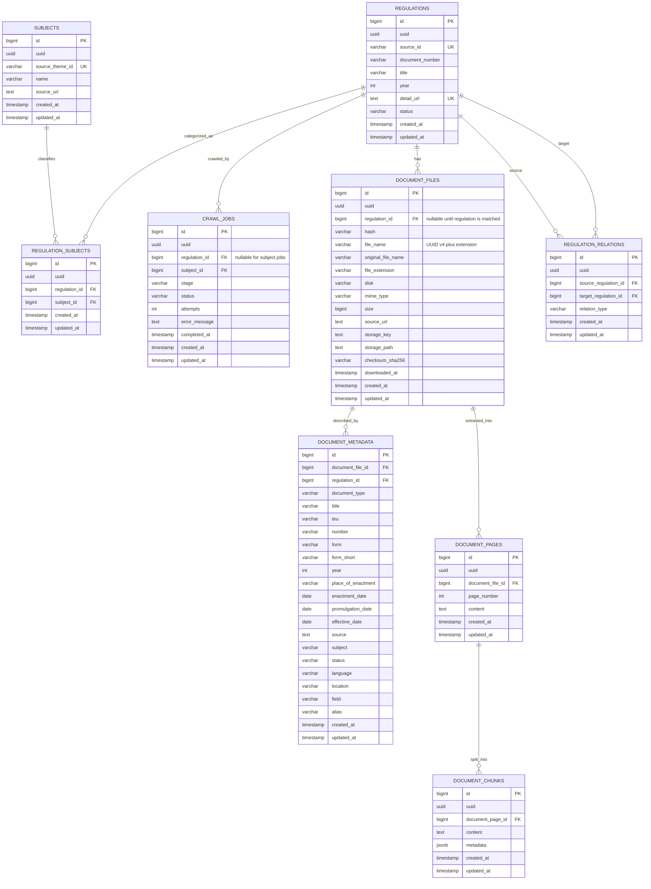

[Project documentation](docs/README.md) covers setup, architecture, crawler workflow, data model, operations, and development.

## Downloaded file storage metadata

The `document_files` table records one row for each successfully downloaded file. New downloads use a canonical UUID v4 filename (`<uuid>.<extension>`) so the original source name cannot overwrite a previously stored file. `file_name` stores the generated filename; `original_file_name` preserves the name from the HTTP `Content-Disposition` header or source URL. `uuid` stores that same UUID as a database UUID value.

| Column | Type | Meaning |
| --- | --- | --- |
| `uuid` | UUID, unique | UUID v4 used in the local filename |
| `file_name` | varchar | Full UUID-derived filename including extension |
| `original_file_name` | varchar | Filename supplied by the source |
| `file_extension` | varchar(32) | Lowercase extension, including the dot |
| `downloaded_at` | timestamptz | UTC timestamp when the response finished downloading |
| `storage_path` | text | Absolute path to the stored local file |
| `storage_key` | text | Optional object key when the file is copied to RustFS |
| `disk` | varchar | Storage backend identifier (`local`) |
| `size` | bigint | File size in bytes |
| `mime_type` | varchar(100) | Response MIME type, with a filename-based fallback |
| `checksum_sha256` | varchar(64) | SHA-256 checksum of the downloaded bytes; also copied to legacy `hash` |
| `source_url` | text | URL from which the file was downloaded |
| `regulation_id` | bigint, nullable FK | Optional link when the related regulation has been identified |

Downloads are written to a temporary file in the destination directory first. After the write succeeds, the complete file is atomically linked under its UUID filename, then its metadata is inserted in a database transaction. Filesystem and database UUID collisions are retried with a new UUID. If the database insert/commit fails, the transaction rolls back and the newly published file is removed. Compose runs Alembic in a one-shot `migrate` service after PostgreSQL is healthy; the crawler service starts only after that migration service exits successfully. `make migrate-db` is also available to apply migrations manually.

On a regulation detail page, the crawler reads each `.row` containing a `.col-lg-3.fw-bold` label and its `.col-lg-9` value. The Indonesian labels (`Tipe Dokumen`, `T.E.U.`, `Bentuk Singkat`, `Tanggal Penetapan`, and the rest) are mapped to their matching `document_metadata` fields. Indonesian month names are parsed as dates. Metadata is stored once per regulation and can exist even when there is no downloadable PDF. When files are downloaded, the metadata row references the first file; each file row separately references its regulation. Migrations `20261012_0003`–`20261012_0006` align the database columns, indexes, and workflow status schema with the ORM while preserving existing metadata.

## Crawler workflow

Run the crawler with `docker compose up -d --build`. Compose waits for PostgreSQL's readiness check, runs the dedicated migration service once, and starts the crawler only after migrations succeed. It fetches `/Subjek`, persists each subject and its `/Search?tema=<id>` URL, follows all pagination links, upserts regulation IDs and `/Details/<id>/<slug>` URLs, then extracts detail metadata and downloads every PDF link. Regulation metadata is stored once per regulation and linked to its first downloaded file when available; a regulation without PDFs can still retain its scraped metadata.

`crawl_jobs` tracks subject stages (`subjek_extracted`, `peraturan_list_extracted`) and regulation stages (`peraturan_list_extracted`, `detail_processing`, `completed`, `failed`). Completed/failed regulation jobs have `completed_at`; failures retain the error message and attempt count. HTTP GETs default to three attempts with exponential retry delays and a 0.5-second minimum interval between requests. Set `CRAWLER_REQUEST_DELAY_SECONDS` to tune the interval. The run prints discovered and completed subjects/regulations, total completed entities, failures, and downloaded PDFs.
