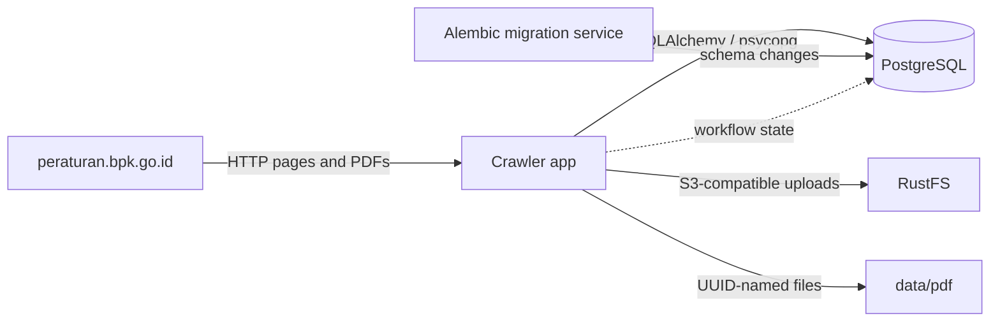

# Architecture

## Runtime overview

The app is a batch process, not an HTTP server. The package entry point is `src/playright_peraturan_bpk/__main__.py`, which invokes `main()` in `main.py`. `main()` creates a `BPKCrawler` and calls `run()`.

## Main modules

- `main.py` contains HTTP fetching, HTML parsing, crawl orchestration, metadata extraction, downloads, and persistence.
- `database.py` builds the SQLAlchemy engine and session factory using `DATABASE_URL` or the `POSTGRES_*` variables.
- `models.py` declares SQLAlchemy entities and relationships.
- `migrations/env.py` loads the model metadata and configured database URL for Alembic.
- `migrations/versions/` defines ordered schema changes.

## Compose startup dependency chain

PostgreSQL must pass `pg_isready` before `migrate` runs. The `app` service waits for `migrate` to complete successfully and for RustFS to start. RustFS is not configured with a Compose health check, so `service_started` means its container has started, not that it is already accepting S3 requests. Local PDF download remains available independently of RustFS upload.

## Persistence boundaries

PostgreSQL stores subjects, regulations, crawl state, document metadata, file metadata, and the page/chunk/relation structures. Downloaded PDFs are first published locally under UUID-derived names; when RustFS is configured, the object key is persisted with the file metadata. The Compose bind mount keeps local PDFs under `data/pdf` on the host.
