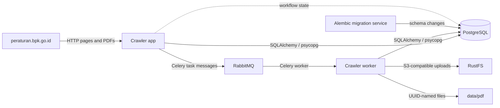

# Architecture

## Runtime overview

The app discovers subjects and regulations, persists them, and submits Celery tasks containing regulation IDs to RabbitMQ's durable `regulation_crawl` queue. Celery workers consume those tasks and fetch details and PDFs. Set `CRAWLER_MODE=inline` to process regulations locally with a bounded thread pool controlled by `CRAWLER_THREADS`. A shared rate limiter keeps request spacing consistent across those threads.

## Main modules

- `main.py` contains HTTP fetching, HTML parsing, crawl orchestration, metadata extraction, downloads, and persistence.
- `database.py` builds the SQLAlchemy engine and session factory using `DATABASE_URL` or the `POSTGRES_*` variables.
- `models.py` declares SQLAlchemy entities and relationships.
- `migrations/env.py` loads the model metadata and configured database URL for Alembic.
- `migrations/versions/` defines ordered schema changes.

## Compose startup dependency chain

PostgreSQL must pass `pg_isready` before `migrate` runs. The producer and Celery worker wait for migration and RabbitMQ health. `rabbitmq.conf` permits the transient startup reply queue and global QoS used by the current Celery AMQP transport with RabbitMQ 4. Celery late-acknowledges tasks, cancels active late-ack tasks on broker connection loss so they can be redelivered, and retries failed regulation processing up to three times with backoff; failures are recorded in `crawl_jobs`. RustFS is not configured with a Compose health check, so `service_started` means its container has started, not that it is already accepting S3 requests. Local PDF download remains available independently of RustFS upload.

## Persistence boundaries

PostgreSQL stores subjects, regulations, crawl state, document metadata, file metadata, and the page/chunk/relation structures. A PDF's SHA-256 checksum is its idempotency key and has a unique database index, so concurrent Celery tasks reuse the existing file instead of creating duplicates. Downloaded PDFs are first published locally under UUID-derived names; when RustFS is configured, the object key is persisted with the file metadata. The Compose bind mount keeps local PDFs under `data/pdf` on the host.
