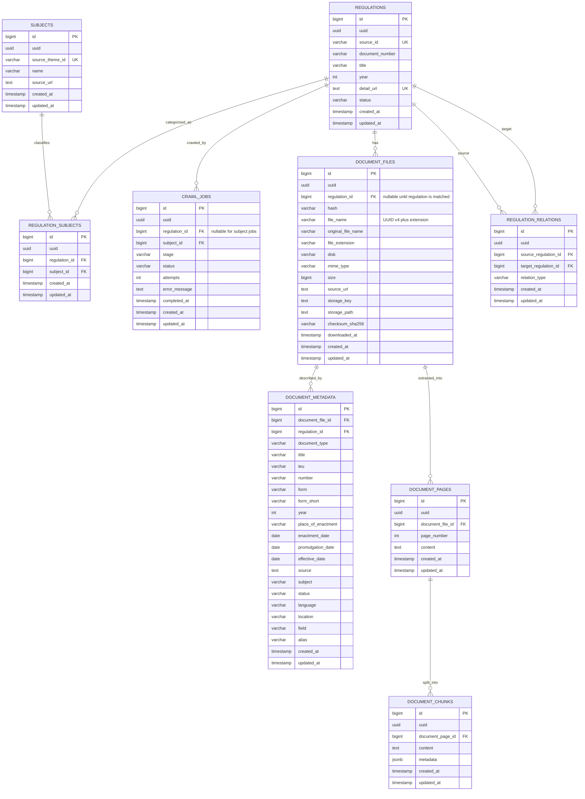

# Entity relationship diagram

The schema below reflects the ORM declarations in `src/playright_peraturan_bpk/models.py` and the Alembic migrations under `migrations/versions/`, which are the source of truth for deployed schema changes.

## Entity notes

`document_files` records one row per successfully downloaded file, with a canonical UUID v4 filename (`<uuid>.<extension>`) so an original source name cannot overwrite a previously stored file. `file_name` stores the generated filename; `original_file_name` preserves the name from the HTTP `Content-Disposition` header or source URL. `uuid` stores that same UUID as a database UUID value.

`document_metadata` can exist for a regulation that has no downloadable PDF, so the link to `document_file` is nullable. `crawl_jobs` optionally references a subject or a regulation; the `regulation_id` is nullable for subject jobs.

See [Data model](data-model.md) for the entity-by-entity summary and [Downloaded file storage metadata](../README.md#downloaded-file-storage-metadata) for the `document_files` column reference.
